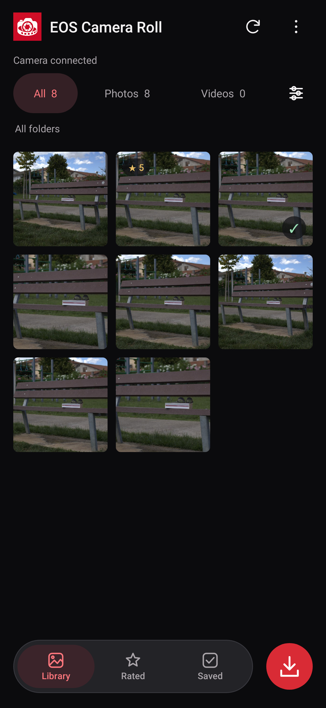
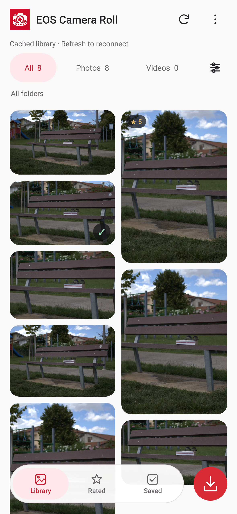

<p align="center"></p>
<h1 align="center">EOS Camera Roll</h1>
<p align="center">Browse, cull and copy original photos and videos from a Canon EOS camera to Android.</p>
<p align="center"><a href="https://github.com/Wizhill05/EOS-Camera-Roll/releases/latest">Download the latest APK</a></p>

EOS Camera Roll is an independent Android companion built around Canon's Camera Control API. It connects directly to the camera over Wi-Fi or a phone hotspot. No desktop or cloud server is required. Development and user testing have focused on the EOS R50 V.

## Gallery

A red-accented gallery with rounded, proportioned photo tiles, dark/light/system appearance, and floating Library / Rated / Saved navigation. Folder and star filters are in the filter sheet; copy actions are in the download sheet. The viewer supports original JPEG and RAW zoom, video playback and seeking, local ratings, saving and Lightroom handoff.

<table><tr><td></td><td></td></tr></table>

These are rendered Android test screens using crops of a public-domain EOS R50 V sample, not live-camera screenshots. [Sample provenance](docs/verification.md).

## Connect and use

1. Enable CCAPI on the camera and connect the camera to your phone's hotspot, or join the camera's Wi-Fi from the phone.
2. Open connection settings from the menu and enter the address shown by the camera. Use Automatic for a camera on your phone hotspot; select camera Wi-Fi when your phone joins the camera network.
3. Enter CCAPI account details only if the camera requires them. Passwords are not persisted.
4. Refresh to read the library. Once loaded, the last library and normalized thumbnails are retained between launches. A cached library is labeled as cached until reconnecting succeeds.
5. Tap a photo to inspect it. Hold a tile to select a batch. Set stars in the viewer or selection bar. Choose a minimum rating in Filters, then save that view from the download sheet.
6. Choose a writable download folder once. Save uses that folder afterward. Copy card makes a new timestamped folder. Green checks identify completed original downloads.

Browsing fetches small thumbnails for the current gallery area, with one bounded worker. It never requests original files to build the grid. Cached thumbnails are reused without per-file network revalidation. Optional small rotation metadata runs after thumbnail work; opening a photo is what loads its full-resolution original.

The app distinguishes a missing device address, an unreachable camera, authentication/access rejection, partial scans, a connected empty card and an empty filter. Cached photos remain visible when refreshing fails.

## Originals and Lightroom

JPEG originals are decoded at full resolution. CR2/CR3 rendering uses bundled LibRaw with EOS R50 V support. The viewer identifies when it is still showing a preview. Video playback uses camera byte ranges when supported and a temporary sequential buffer otherwise. Format and codec support depend on the camera and phone.

Lr sends an individual photo's original to Lightroom through a read-only private content URI, without creating a permanent Downloads copy. Lightroom owns its import, edits and deletion behavior. The app cannot confirm import completion, retrieve edits automatically, or guarantee Adobe's local/cloud cleanup. Temporary handoffs are cleaned after the last reader releases them, with startup expiry cleanup after interruptions. [Storage and feature details](MEDIA.md).

Ratings are local to the app. A saved check is a receipt for a completed original copy, not continuous monitoring of later file deletion. Camera files are not modified or deleted.

## Install

Download the APK from [Releases](https://github.com/Wizhill05/EOS-Camera-Roll/releases/latest). Android 10 or newer and an arm64 phone are required for this build. Install over the existing Camera Link Lab / Camera roll installation to keep settings, ratings and receipts. The package remains `dev.aryan.cameralinklab` for update compatibility.

## Build and release

Use JDK 21, Android SDK platform 36 and build tools 36.0.0:

```bash
./gradlew :app:assembleRelease :app:lintRelease :app:testDebugUnitTest
bash check-protocols.sh
bash check-ccapi-links.sh
bash check-media.sh
```

The source includes the pinned arm64 RAW decoder and its complete source. [Native build instructions](native/README.md).

Pushing a new app version to `main` runs the GitHub release workflow. It tests, builds, signs with the configured update-compatible key and publishes the APK and checksum to GitHub Releases. A duplicate version fails before publication, requiring versionCode/versionName to be bumped. Local deliverable builds use `scripts/release.sh`, which runs the same checks and publishes the result. [Release setup](docs/releasing.md).

The personal development certificate is preserved for existing installations; this is not a Play Store signing setup. Public source does not contain a signing key or credentials.

## Status and license

The prior app's basic browsing and transfers have been reported working on the physical R50 V. This release has local Android workflow, orientation, cache, protocol and transfer checks. Physical-device validation of this redesign, native RAW rendering performance, vendor background behavior and Lightroom import is still required. [Verification](docs/verification.md).

App code is MIT licensed. LibRaw is distributed under its CDDL option, with exact source and notices included. AndroidX and other dependencies retain their own licenses. [Third-party notices](THIRD_PARTY.md).

EOS and Canon are trademarks of their respective owners. This project is independent and is not an official Canon or Adobe application.
